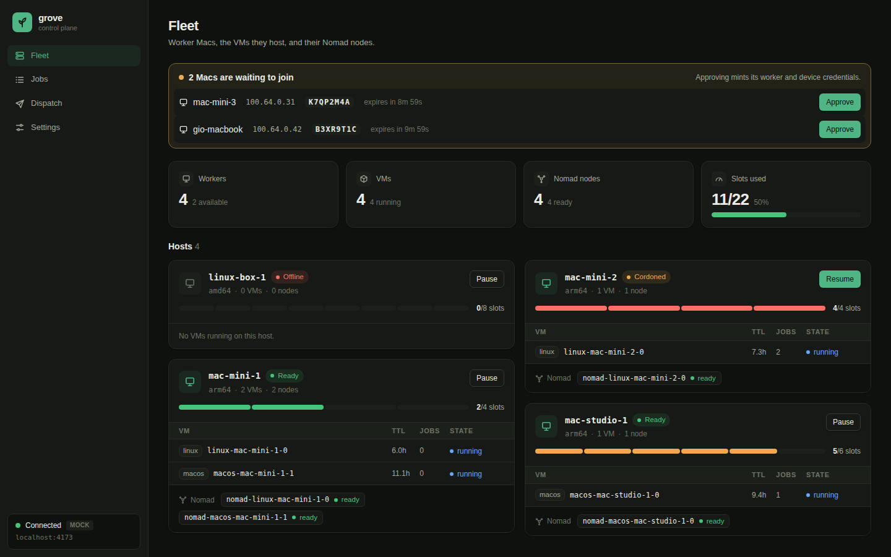
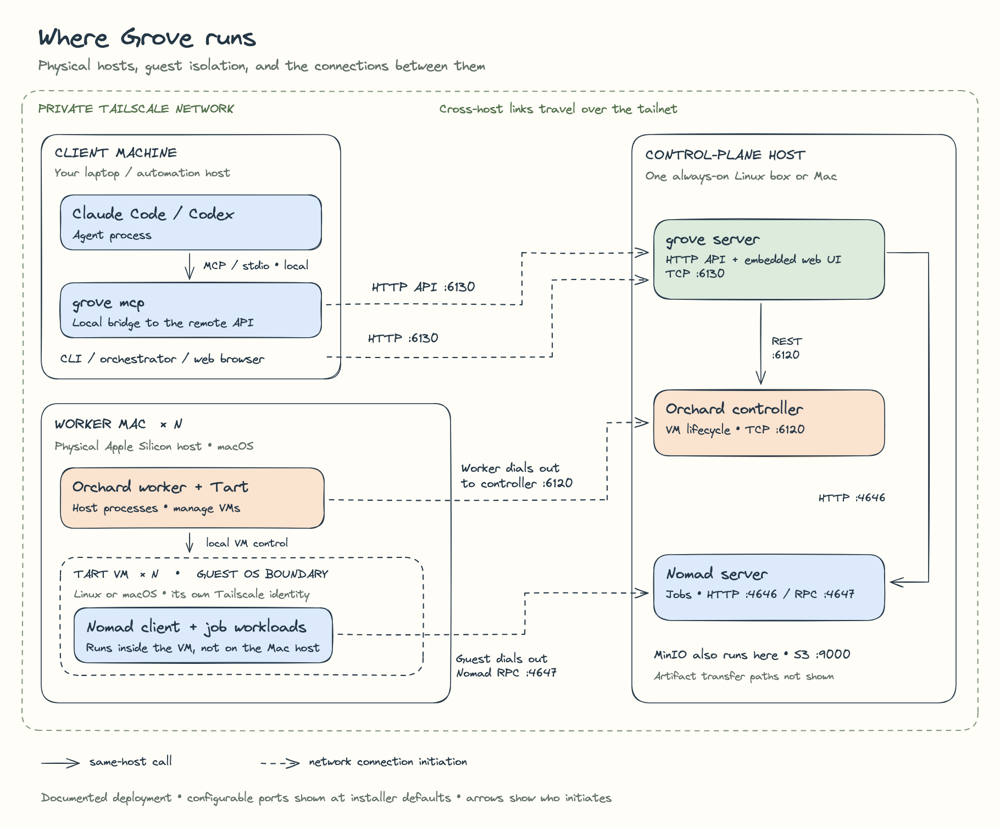
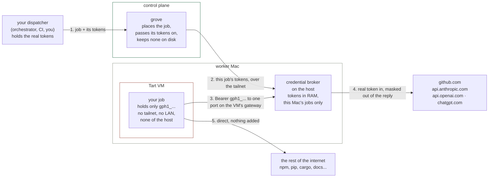

# grove

grove turns your Apple Silicon Macs into a private cloud for CI
builds, deploys, and coding-agent sessions — VM-isolated, packed tightly with a real job
scheduler, and reachable only over your Tailscale tailnet. The control-plane runs on Linux or macOS.

## Why

Mac CI is expensive, and the tooling around it is thin. GitHub Actions bills macOS minutes at roughly 10x the Linux
rate, there is no macOS container runtime (every "Mac as a k8s node" story is a third-party
virtual-kubelet), and Apple's Virtualization.framework allows only two VMs per Mac — so the
usual one-VM-per-job setup caps each machine at two concurrent jobs.

grove runs jobs on Macs you already own, with no per-minute bill. Each Mac runs **Tart** VMs,
and each VM runs a **Nomad** client that packs many jobs inside it: the VM is the isolation
boundary, Nomad is the scheduler within it. Every job — CI or agent — runs inside a VM, not
next to your other work on the bare host.

## Fleet at a glance



## Quick start

```bash
# on each Mac you want in the fleet
# (or just open http://<control-plane>:6130/join on it — same commands, and a QR to
#  send the link to another device)
brew tap gm2211/grove https://github.com/gm2211/grove
brew install grove
grove setup

# opens Map through a localhost bridge; device token stays in Keychain
grove ui

# already installed? upgrade in place any time:
brew upgrade grove

# on the always-on box (Linux, or a dedicated Mac)
grove install --role control-plane

# grove setup discovers this control plane over Tailscale. It prints a short approval code.
# Approve it from the Fleet page in `grove ui` (it lists whoever is waiting), or here:
grove join approve <CODE>

# from anywhere on the tailnet: create the worker VMs from fleet.yaml
grove fleet apply

# run a one-off shell command on the macos pool, streaming logs live
grove dispatch --pool macos --kind shell --follow -- 'echo hi'

# run a build on the linux pool against a real repo/ref
grove dispatch --pool linux --kind build --repo https://github.com/you/app --ref main -- 'make test'

# watch, list, and check on jobs after the fact
grove logs <id> --follow
grove jobs ls
grove fleet status

# is everything healthy?
grove doctor
```

Every enrolled Mac is both worker and dispatcher. Grove keeps shared scheduling state on one
control-plane host, but an agent, a CI script, or a human can inspect and submit work from any enrolled
device. Each device has its own revocable `read + build + agent` credential; raw shell jobs
(operator or an explicit `dispatch:shell` credential) and named secrets remain privileged. Only control-plane
operator credentials can approve/revoke devices or change worker/VM state.

Full walkthrough (roles, flags, failure modes like the macOS 15+ Local Network permission popup):
[docs/INSTALL.md](docs/INSTALL.md).

## Use from Claude Code / Codex

```bash
claude mcp add grove -- grove mcp
```

`grove mcp` exposes the fleet over MCP (stdio) — `grove_fleet`, `grove_run`, `grove_job_status`,
`grove_job_logs`, `grove_job_cancel`, `grove_recycle_vm`, `grove_pause_worker` — so an agent can
dispatch and follow its own jobs without shelling out to the CLI. Example prompt:

> Run this repo's test suite on the `linux` pool and tell me if it passes.

See [docs/MCP.md](docs/MCP.md) for Codex / Claude Desktop registration and the full tool list.

## Use from an agent orchestrator

An orchestrator's `grove` executor drives grove over the same HTTP API as everything else: `POST
/jobs` to submit a work unit, `GET /jobs/{id}` to poll, NDJSON log streaming with offset-based
resume, and an `idempotencyKey` convention (`<orchestrator>:<taskId>:<runId>`) that makes retries
safe. See [docs/ORCHESTRATOR.md](docs/ORCHESTRATOR.md) for the full work unit → JobRequest mapping
and status vocabulary.

## How it works



[Editable Excalidraw source](docs/diagrams/architecture.excalidraw) ·
[SVG](docs/diagrams/architecture.svg)

Solid outlines identify physical host roles; the nested dashed VM outline marks guest OS
isolation. The outer green outline is the private Tailscale network. A control-plane role
can run on Linux or a Mac; the diagram separates roles for clarity.

Solid arrows are same-host calls. Dashed arrows show network connection initiation:
clients reach Grove's API, Orchard workers reach the controller, and Nomad clients inside
VMs reach the Nomad server. `grove mcp` speaks stdio locally to its agent and HTTP to the
remote Grove API. Ports show installer defaults, not a live deployment audit. Build artifacts are kept in a
directory on the control-plane host; artifact transfer paths are omitted.

See [docs/FLOW.md](docs/FLOW.md) for the full layering diagram plus a sequence diagram for one
job end to end and the VM recycling loop.

Three separate systems, deliberate seams:

| Layer | Owns | Never knows about |
|---|---|---|
| **Orchard** (our fork) | VM lifecycle: create, place, restart, TTL, delete | jobs, Nomad |
| **Nomad** | job scheduling *inside* VMs: placement, packing, queueing, retries, logs | VMs, Tart, Orchard |
| **grove** | desired fleet state, job submission API, UI, install | — it's the only layer that sees both |

Full design, fleet spec, job model, and HTTP API reference: [ARCHITECTURE.md](ARCHITECTURE.md).

## Jobs never hold your tokens

A job has to sign in somewhere — push to GitHub, call an AI provider. But anything running in
that job can read its environment: a dependency's install script, an instruction hidden in a
file the agent reads, the agent itself. So grove doesn't put the real token there.

The dispatcher sends the token *with* the job (`"credentials": [...]`, see
[docs/JOBS.md](docs/JOBS.md)). The job's environment gets a `gph1_…` placeholder instead, and a
credential broker on that job's own Mac swaps the real token in on the way to the service it
belongs to — then masks it back out of the reply.



Three things hold that up:

- **A placeholder is worth nothing anywhere else.** 256 random bits, for one job, held only in
  that Mac's broker memory and never on disk. It dies when the job ends, when its lease runs
  out, when the VM goes, or when the broker restarts.
- **Only a short list of hosts is ever handed a token.** The broker terminates TLS for those
  hosts alone, with a CA name-constrained to them that is trusted only inside the VM, and a
  token of one kind can only go to its own service's hosts. Everything else is tunnelled
  untouched, with nothing added.
- **The VM can reach that one port and nothing else of yours.** Not the host, not the tailnet,
  not your LAN — the guest's own firewall allows the broker's port on its gateway and fences
  off every other private address.

A long-running job keeps working: its placeholder never changes while the dispatcher puts a
fresh token behind it (`PUT /api/v1/jobs/{id}/credentials`) for as long as the job runs.

Named secrets (`"secrets": [...]`) still exist for a value the broker can't swap — a sign-in a
CLI reads from a file, say — and for sealed pools, whose VMs reach no broker. A job does hold
those. See [docs/OPERATIONS.md](docs/OPERATIONS.md) ("The credential broker", "Named secrets
for jobs").

## What works today

- fleet reconciler that keeps Orchard VMs matching `fleet.yaml`, including per-VM TTL and
  shutdown hooks, plus a background reconcile loop in `grove serve`
  (`--fleet-reconcile-interval`, `--no-fleet-reconcile`)
- parameterized Nomad jobs for `build` / `agent` / `shell`, dispatched and tracked end to end,
  with resumable NDJSON log streaming and stuck/orphaned-job detection (`lost` status)
- credential broker on every worker Mac: a job's sign-ins reach it as `gph1_…` placeholders and
  the real tokens never enter the VM (see "Jobs never hold your tokens" above)
- HTTP API (`/api/v1/...`) + embedded control-plane UI (fleet view, job list, job detail with
  live logs, dispatch form, settings)
- MCP server for orchestrators (Claude Code, Codex, your own agent runner) to dispatch and follow
  jobs over stdio
- `grove install` role bootstrap (`worker` / `control-plane` / `client`) and `grove doctor`
  health checks
- agent-orchestrator executor contract — see [docs/ORCHESTRATOR.md](docs/ORCHESTRATOR.md)

## Not yet

- only live-tested on a single-host smoke stack, not a multi-Mac fleet
- worker images (`ghcr.io/gm2211/grove-linux-worker`, `ghcr.io/gm2211/grove-macos-worker`, tags
  `latest` + date) are published but private by default — make the GitHub packages public or pass
  `grove install --role worker --registry-token …` (see [docs/IMAGES.md](docs/IMAGES.md))
- per-dispatch CPU/memory sizing (`JobRequest.Resources`) is validated but not yet applied to the
  running job — see [docs/JOBS.md](docs/JOBS.md) "Per-job resource sizing"

See [CHANGELOG.md](CHANGELOG.md) for what shipped in each release.

## Requirements

| | |
|---|---|
| **Hardware** | Apple Silicon Mac for any `worker`; macOS or Linux for `control-plane`; anything for `client` |
| **OS** | macOS 15+ (for the Local Network permission worker Macs need) |
| **Tailscale** | standalone variant, already authenticated — **not** the Mac App Store build (it doesn't start before login) |
| **Homebrew** | grove is its own tap; on recent Homebrew you may need `brew trust openai/tools` before Tart will install |
| **Registry access** | grove's worker images on `ghcr.io` are private by default — make the GitHub packages public, or `grove install --role worker --registry-token …` (see [docs/INSTALL.md](docs/INSTALL.md)) |

grove installs everything else itself (Tart, Nomad, Orchard).

## Docs

| Doc | Covers |
|---|---|
| [ARCHITECTURE.md](ARCHITECTURE.md) | Full design: layering, fleet spec, job model, HTTP API |
| [docs/FLOW.md](docs/FLOW.md) | Mermaid diagrams: layering, one job end to end, the recycling loop |
| [docs/INSTALL.md](docs/INSTALL.md) | Role-by-role install walkthrough and failure modes |
| [docs/OPERATIONS.md](docs/OPERATIONS.md) | Day-2 ops: recycling, image rollouts, pausing a Mac, logs, upgrading |
| [docs/JOBS.md](docs/JOBS.md) | The `JobRequest` ↔ Nomad job contract |
| [docs/MCP.md](docs/MCP.md) | The MCP server: tools, resources, client registration |
| [docs/ORCHESTRATOR.md](docs/ORCHESTRATOR.md) | The agent-orchestrator executor contract |
| [docs/IMAGES.md](docs/IMAGES.md) | Building and pushing the Tart/container images |
| [CHANGELOG.md](CHANGELOG.md) | Release notes |

## License

MIT
