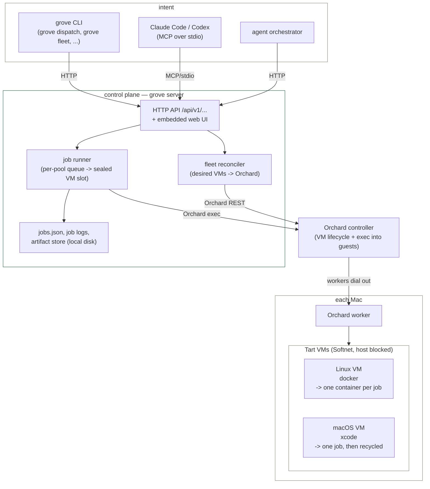
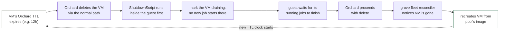

# grove — flow diagrams

Three views of the same system, each answering a different question. See
[ARCHITECTURE.md](../ARCHITECTURE.md) for the prose version of the layering and the fleet/job
contracts these diagrams summarize.

## 1. Layering — who talks to what

Intent flows down through one control plane, which both keeps the fleet of VMs (through Orchard)
and runs every job in those VMs (also through Orchard). Nothing inside a VM dials home: every VM
is sealed.



Two systems (see ARCHITECTURE.md's "The layering" table for what each owns and never knows
about): **Orchard** owns VM lifecycle, **grove** owns the fleet spec, the job queue and the
runner, and is the only layer that sees both.

## 2. One job, start to finish

`grove dispatch` (or the MCP `grove_run` tool, or an orchestrator's executor) to a finished job
with logs and an exit code:

```mermaid
sequenceDiagram
    participant U as grove dispatch
    participant API as grove server\n(/api/v1/jobs)
    participant Q as pool queue + runner\n(in grove serve)
    participant O as Orchard
    participant VM as sealed VM

    U->>API: POST /api/v1/jobs\n{kind, pool, repo, ref, script, timeout}
    API->>Q: validate, record in jobs.json, spool env (0600)
    API-->>U: 201 {"id": "j-8f2"}

    Q->>Q: wait for this pool's turn and a free VM slot
    Q->>Q: git clone repo@ref on the control plane\n(armed token only here; build/agent only)
    Q->>O: exec: push checkout + script into the VM
    O->>VM: run in a fresh container (Linux)\nor as the job user (macOS)
    VM-->>Q: stdout/stderr (followed) -> logs/<id>.log
    VM-->>Q: exit code
    Q->>O: exec: copy ./artifacts out (build)

    U->>API: GET /api/v1/jobs/j-8f2/logs?follow=1&sinceOffset=N
    API-->>U: NDJSON {offset, ts, stream, line} from logs/<id>.log

    U->>API: GET /api/v1/jobs/j-8f2
    API-->>U: {"status": "success", "exitCode": 0, ...}
```

Kinds differ only in what runs around the script (see docs/JOBS.md): `build` collects
artifacts, `agent` gets a longer stop grace, `shell` skips the clone entirely.

## 3. Recycling loop — nothing is cleaned, only replaced



The guest drains itself; a job a draining VM refuses is retried by grove on another VM before it
starts (ARCHITECTURE.md's "Recycling / hygiene"). A macOS VM is deleted after the one job it ran
and comes back the same way.

Same mechanism drives a forced recycle (`POST /api/v1/vms/{name}/recycle`, or the MCP
`grove_recycle_vm` tool) — it's the TTL-expiry path run on demand instead of waiting for the
clock, then the reconciler takes over exactly as above.
